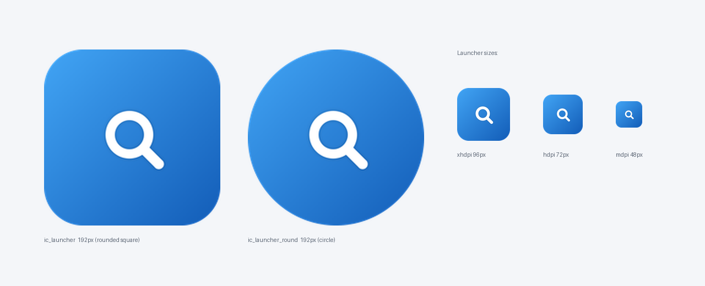

# PanSou 盘搜 · Android 客户端

<p align="center">
  
</p>

**PanSou 盘搜**的原生 Android 客户端（Kotlin + Material Design），
直连 [pansou-web](https://github.com/fish2018/pansou-web) 后端 API，
聚合 Telegram 频道与搜索插件的网盘资源（夸克 / 阿里云盘 / 百度网盘 / 迅雷 / UC …）。

> 后端服务器地址可在应用内自定义（支持内网 http），不绑定任何公共服务。

## 功能特性

- 🔍 **资源搜索** —— 聚合多源搜索，卡片式结果列表（标题 / 网盘类型 / 来源频道 / 时间 / 提取码）
- 🏷️ **类型筛选** —— 按网盘类型过滤结果，带数量统计芯片
- ✅ **链接有效性检测** —— 搜索完成后批量检测（`/api/check/links`），
  自动移除失效链接，确认有效的资源标注「✓ 有效」徽标
  - 实测规则：`ok` → 保留+徽标；`bad`/`uncertain` → 移除；`locked`（需提取码）/`unsupported` → 保留
- ⚙️ **搜索配置**（与网页版配置页一致）—— 数据源（全部 / Telegram / 插件）、
  结果类型、网盘类型、插件列表、频道列表、强制刷新
- 🌐 **自定义后端** —— 设置页修改服务器地址，带「测试连接」；内网 http 明文已放行
- 🧊 **液态玻璃 UI** —— 搜索栏、操作弹窗、设置页均为玻璃拟态设计
- ℹ️ **关于页** —— 版本号动态读取打包信息，主页亦显示当前版本

## 截图

| 图标 | 主页 |
|---|---|
|  | 主页为玻璃搜索栏 + 卡片结果列表 |

## 快速开始

### 下载安装

从 [Releases](../../releases) 下载 APK 安装（需允许「未知来源」）。

### 使用

1. 打开应用 → 右上角 ⚙️ 进入设置
2. 填入你的 pansou-web 后端地址（如 `http://192.168.9.110:1080/`）
3. 「测试连接」确认可达 → 「保存」
4. 回到主页输入关键词搜索；搜索完成后自动检测并只保留有效链接

## 构建

### 环境要求

- JDK 17+（实测 JDK 21）
- Android SDK：`platforms;android-34`、`build-tools;34.0.0`
- Gradle 8.x（或 Android Studio 自带）

### Android Studio

1. 打开本目录，等待 Gradle 同步（首次需联网下载依赖）
2. `Build > Build APK(s)` → `app/build/outputs/apk/`

### 命令行

```bash
export ANDROID_HOME=/path/to/android-sdk
gradle wrapper --gradle-version 8.7   # 首次生成 wrapper

./gradlew testDebugUnitTest    # 单元测试
./gradlew assembleDebug        # 调试版
./gradlew assembleRelease      # 发布版（需配置签名，见下）
```

## 签名配置

release 构建从 `keystore.properties` 读取签名信息（**不要**把 keystore 和该文件提交到公开仓库）：

```bash
# 1. 生成自己的证书
keytool -genkey -v -keystore my.keystore -alias myalias \
  -keyalg RSA -keysize 2048 -validity 10000

# 2. 复制模板并填写
cp keystore.properties.example keystore.properties
```

`keystore.properties`：

```properties
storeFile=my.keystore
storePassword=你的密码
keyAlias=myalias
keyPassword=你的密码
```

> ⚠️ 丢失 keystore 将无法对同一包名发布覆盖升级，请妥善备份。

## 后端 API

客户端对接 [pansou-web](https://github.com/fish2018/pansou-web) 的两个接口：

### 搜索

```
GET {base}/api/search?kw={关键词}&res=merge
    &src=all|tg|plugin        # 数据源
    &cloud_types=baidu,quark   # 网盘类型过滤（可选）
    &plugins=...&channels=...  # 插件/频道（可选）
    &refresh=true              # 强制刷新（可选）
```

响应（节选）：

```json
{
  "code": 0,
  "data": {
    "total": 135,
    "merged_by_type": {
      "quark": [
        {
          "note": "资源标题",
          "url": "https://pan.quark.cn/s/xxxx",
          "password": "abcd",
          "datetime": "2026-10-16T05:31:15Z",
          "source": "tg:channel_name"
        }
      ]
    }
  }
}
```

### 链接检测（批量）

```
POST {base}/api/check/links
Content-Type: application/json

{"items": [
  {"disk_type": "quark", "url": "https://pan.quark.cn/s/xxxx"},
  {"disk_type": "baidu", "url": "https://pan.baidu.com/s/xxxx"}
]}
```

响应：

```json
{
  "results": [
    {"disk_type": "quark", "url": "…", "state": "ok",  "summary": "链接有效"},
    {"disk_type": "baidu", "url": "…", "state": "bad", "summary": "分享不存在"}
  ]
}
```

`state` 取值：`ok` / `bad` / `locked` / `uncertain` / `unsupported` / `pending` / `idle`

## 项目结构

```
├── app/src/main/
│   ├── AndroidManifest.xml
│   ├── java/com/pansou/app/
│   │   ├── MainActivity.kt        # 搜索主界面（结果列表、类型筛选、批量检测）
│   │   ├── SettingsActivity.kt    # 设置（后端地址、搜索配置、链接检测开关、关于）
│   │   ├── ResultAdapter.kt       # 结果列表适配器（含「✓ 有效」徽标）
│   │   ├── Api.kt                 # 后端 API 客户端（搜索 / 批量链接检测）
│   │   └── Prefs.kt               # SharedPreferences 封装
│   └── res/
│       ├── layout/                # activity_main / activity_settings / item_result / dialog_item_actions
│       ├── drawable/              # 液态玻璃背景、图标
│       └── xml/network_security_config.xml   # 内网 http 明文放行
├── app/src/test/                  # 单元测试（基于真实 API 抓包数据）
│   └── resources/search-sample.json
├── screenshots/                   # README 截图
├── keystore.properties.example    # 签名配置模板
└── build.gradle.kts
```

## 测试

单元测试覆盖 API 响应解析、状态判定规则（真实抓包样本）：

```bash
./gradlew testDebugUnitTest
```

## 版本历史

| 版本 | 内容 |
|---|---|
| 1.6 | 关于页 / 版本号显示 |
| 1.5 | 链接检测修复：`uncertain` 状态死链也移除 |
| 1.4 | 「✓ 有效」徽标；精简交互 |
| 1.3 | 批量链接检测（自动过滤失效链接）；图标居中 |
| 1.2 | 液态玻璃 UI；搜索配置页；链接检测 |
| 1.1 | 原生重写：搜索 / 设置 / 清空返回 |
| 1.0 | WebView 壳原型 |

## 常见问题

- **内网 http 打不开？** 应用已全局放行明文流量；确认手机与后端在同一网络。
- **更新安装失败？** 需与旧版使用同一签名；如自行构建，请一直用自己的 keystore。
- **桌面图标没变？** 系统会缓存旧图标，卸载重装即可刷新。

## License

[MIT](LICENSE)

本项目是 [fish2018/pansou-web](https://github.com/fish2018/pansou-web) 的非官方 Android 客户端，
后端服务请遵守其各自的开源协议与使用条款。
